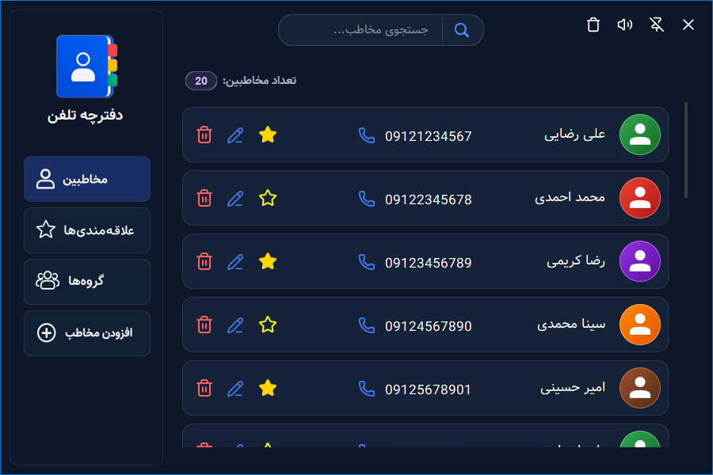
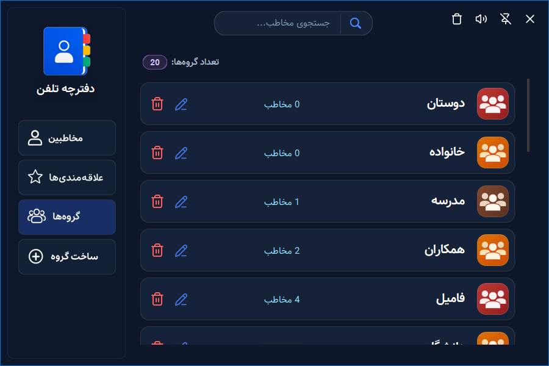
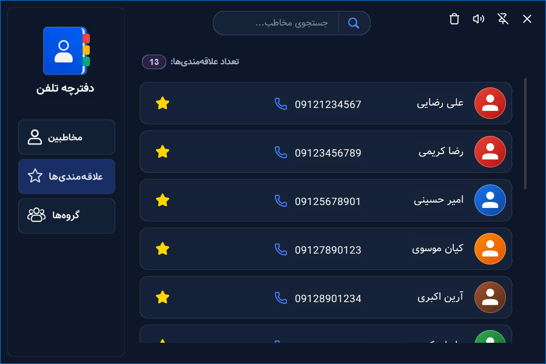
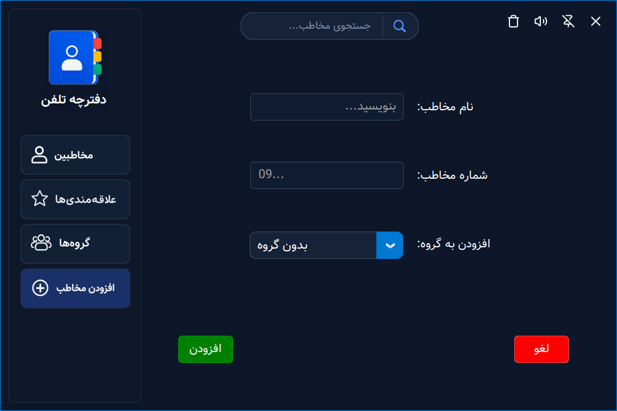

# 📒 PhoneBook

**PhoneBook** یک برنامهٔ مدرن برای مدیریت مخاطبین است که با زبان Python و کتابخانه‌های Tkinter و CustomTkinter توسعه داده شده است.

این برنامه با رابط کاربری گرافیکی مدرن و طراحی Dark، امکان مدیریت مخاطبین و گروه‌ها را به شکلی ساده و منظم فراهم می‌کند.

## ✨ امکانات

- افزودن، ویرایش و حذف مخاطبین
- مدیریت گروه‌های مخاطبین
- افزودن مخاطبین به لیست علاقه‌مندی‌ها
- جست‌وجوی مخاطبین
- امکان انتخاب آیکون با رنگ‌های مختلف برای گروه‌ها
- نمایش تعداد مخاطبین و گروه‌ها
- ذخیره‌سازی اطلاعات در فایل‌های JSON
- رابط کاربری فارسی با طراحی مدرن و Dark
- و سایر امکانات کاربردی...

## 📸 Screenshots

### Contacts


### Groups


### Favorites


### Add Contact


## 🛠️ تکنولوژی‌ها و کتابخانه‌ها

- Python
- Tkinter
- CustomTkinter
- Pillow
- winsound

## 📋 پیش‌نیازها

- سیستم‌عامل Windows
- Python 3.15 یا بالاتر

## 📂 ساختار پروژه

```text
PhoneBook/
│
├── assets/
├── core/
├── models/
├── ui/
├── utils/
│
├── .gitignore
├── __init__.py
├── main.py
├── README.md
├── requirements.txt
└── shared.py
```

## ⚙️ نصب و اجرا

ابتدا مخزن را Clone کنید:

```bash
git clone https://github.com/hosein-t/PhoneBook
```

و وارد پوشهٔ پروژه شوید:

```bash
cd PhoneBook
```

سپس کتابخانه‌های موردنیاز را نصب کنید:

```bash
pip install -r requirements.txt
```

در نهایت برنامه را اجرا کنید:

```bash
python main.py
```

## 💾 ذخیره‌سازی اطلاعات

اطلاعات مخاطبین، گروه‌ها و تنظیمات برنامه در فایل‌های JSON ذخیره می‌شوند.

## 📌 وضعیت پروژه

کدنویسی نسخهٔ فعلی پروژه به پایان رسیده است.
